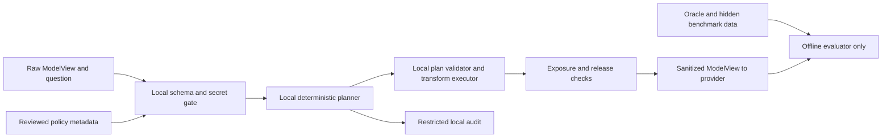

# RFC: task-aware minimum-sufficient transformation planner

Status: design proposal for issue #27. No planner is implemented here. Existing
transformations, benchmark definitions, hashes, and provider protocols are
unchanged. All examples are conceptual descriptions of existing development
families, not new generated instances or experimental results.

## Interface and trust boundaries

```text
plan(ModelView, troubleshooting_question, policy_metadata) -> TransformationPlan
```

The explicit question must equal `ModelView.troubleshooting_question`; reject
conflicting inputs. ModelView itself is a local raw-data trust boundary: its
current name does not imply it is already safe to release. The planner executes
locally without provider/network access and sees no Incident object.



There is no edge from oracle/evaluator to planner, policy selection, or provider.
The offline evaluator may assess a frozen candidate using development-only
ground truth after planning, but that cannot feed per-instance decisions.

`policy_metadata` is independently reviewed schema/policy information: field
classifications, allowed linkage domains, task-contract IDs, capabilities,
budget ceilings, and versions. It is not copied from `Incident.sensitive_fields`
or `diagnostic_invariants` at inference. Benchmark annotations can evaluate
classification accuracy offline; importing oracle labels, expected IDs, hidden
roles, seed-to-answer tables, or target-only requirements is rejected. Require a
strict allowlist of metadata fields and documented provenance.

Treat question text, log messages, source values, and apparent instructions in
evidence as untrusted data. They cannot override policy, widen a budget, select
raw fallback, or request output of local audit/mapping information.

## Property vocabulary and task contracts

Represent requirements as typed relations over schema paths, with subject/join
scope and granularity. Avoid free-text commands or lists of oracle evidence IDs.

| Property | Proposed parameters | Preservation certificate |
|---|---|---|
| Equality/inequality | domain, typed equality, source scope, incident scope | One-to-one mapping within domain, with both equal and unequal witnesses in offline tests |
| Linkage | explicit join group of paths, cross-source permission, retention scope | All allowed paths use the same mapping; unrelated groups cannot alias |
| Shape | length, character class, literal separators, optional declared grammar | Supported signature retained; no implicit check-digit or semantic-prefix claim |
| Temporal | equality/order/strict overlap; precision; duration/gap requirement | Valid parser and relation semantics, complete endpoints for overlap |
| Cardinality/presence | row/source inventory, distinct count, null/event presence | Declared inventory retained or coarsened with visible unsupported status |
| Numeric | typed units, sign/order/equality, ratio/difference or interval precision | Each requested relation proven by registered transform capability |

Relationships apply to every occurrence in the specified schema scope. A planner
must not preserve only the known failing operation. A task may explicitly name
an operation; subject resolution can use that visible question and allowed joins,
but must not use the hidden target role or expected proof path. Prefer the same
profile for a task class across target/twin/control queries.

A task contract describes information sufficient to attempt a diagnostic task,
not a guaranteed diagnosis. Initially use a small reviewed task vocabulary with
deterministic parsing and a generic full-scope contract. Unknown/ambiguous task
classification returns `needs_policy_review`. Do not run an LLM classifier or
match family/seed IDs to hidden answers. Completeness of a contract is a future
empirical question assessed by offline counterexamples and approved studies.

## Proposed policy and plan schema

Illustrative schema only; names below are proposed future capabilities, not
implemented runtime functions or current annotation policies.

```yaml
policy_version: planner-policy-draft-1
schema_version: operations-draft-1
task_contract: lifecycle-diagnosis-draft-1
unknown_field: reject_release
unknown_task: needs_policy_review
field_rules:
  - selector: credentials.*
    classification: secret
    release: forbidden
  - selector: operations.operation_id
    classification: identifier
    join_domain: operation-within-incident
  - selector: logs.attributes.operation_id
    classification: identifier
    join_domain: operation-within-incident
requirements:
  - property: equality_and_inequality
    domain: operation-within-incident
  - property: strict_interval_overlap
    start_paths: [executions.started_at, compensations.started_at]
    end_paths: [executions.completed_at, compensations.completed_at]
allowed_profiles: [scoped-identity-plus-relative-time-draft-1]
budget:
  direct_identifier_release: forbidden
  cross_incident_linkage: forbidden
  cross_source_linkage: [operation-within-incident]
  temporal_precision: milliseconds
  exact_duration_release: allowed
  record_presence_release: allowed
  record_cardinality_release: allowed
  shape_release: forbidden
```

Paths must resolve against the declared schema; wildcards cannot silently match
new fields. A compiled inventory lists all matched paths and classifications,
including question text and log messages. Any unclassified field blocks release.
The secret detector also scans values and text; classifier uncertainty blocks
the entire request instead of permitting raw fallthrough. A public test-vector
key is allowed only in local test metadata, never because its spelling resembles
a benign value. Secrets are never hashed into stable provider-visible tokens.

The plan contains `status`, `policy_version`, `schema_version`, `contract_id`,
`capability_registry_version`, ordered transforms with scoped parameters,
preserved/discarded property IDs, conservative exposure bounds, budget decisions,
and sanitized reason codes. `status` is `ready`, `needs_policy_review`, or
`infeasible`. A non-ready plan contains no releasable payload or partial raw view.

A `ready` plan is a local instruction to a trusted executor, not direct provider
output. Secret/mapping handles remain opaque and local. The executor validates
actual postconditions, transformed query references, and whole-payload exposure
before release. If any check fails, release is blocked with a payload-free error.
Provider input contains only sanitized ModelView plus the fixed task prompt;
no plan, rationale, oracle labels, or diagnostic hints are appended.

## Selection objective and deterministic behavior

Let C be a reviewed finite registry of transformation profiles, R(q,p) the
requirements of the approved task contract, E(c,x) a conservative exposure
vector, and B(p) the policy ceiling. Select a candidate whose certified
properties contain R and whose exposure is componentwise within B. Secrets,
unclassified fields, and prohibited linkage are hard constraints, not costs.

Among feasible profiles, remove exposure-dominated candidates, then use an
approved lexicographic priority and fixed profile-ID tie-break. Document that
priority; privacy dimensions are not naturally commensurate. If no candidate
meets the contract and budget, return `infeasible`, even if raw evidence could
support diagnosis. Never silently drop a requirement to fit the budget.

"Minimum-sufficient" means minimal within this frozen registry and contract.
It does not claim global information-theoretic optimality, empirical accuracy,
or completeness of requirements. A diagnostic answer or post-hoc score must not
be used to decide whether to release more properties.

For fixed input, policy, registry, and local scope/key context, canonicalize
paths/sets and produce an identical plan. Separate plan determinism from
pseudonym lifetime: incident-scoped keyed transforms may intentionally use
different scope keys across incidents. Freeze all scope inputs locally without
publishing them as raw-data fingerprints. Row encounter order, wall-clock time,
network results, provider responses, and process RNG state cannot select a plan.

## Exposure and composition

Use the vector and status vocabulary in
[PRIVACY_EXPOSURE_METRICS_RFC.md](PRIVACY_EXPOSURE_METRICS_RFC.md). At planning
time, capabilities provide conservative release bounds and explicitly known
schema/count properties. `unknown` cannot satisfy a strict budget. An empirical
attack-success estimate is not a sound upper bound on a release.

Composition is not the sum of individual scalar costs: equality plus timestamps
or shape can reveal a join that either alone did not. Each supported composition
needs its own certificate and cross-field/cross-source attack tests. If no joint
bound is available, refuse or select a separately certified profile. Whole-view
context, event order, query IDs, errors, and plan selection itself count as
possible exposure channels.

Existing APIs consume an oracle-bearing Incident and annotation set. They cannot
be wired directly into the proposed inference path. A future adapter must take
independently supplied policy plus a ModelView and be versioned separately.
Current HMAC does not enforce per-incident linkage, relative-time retains
identifiers, and current baselines retain record inventory: any stricter budget
can therefore be infeasible with today's capability set. Do not claim the draft
composite profile above already exists.

## Conceptual examples using existing incident families

| Task context | Candidate contract | Exposure tradeoff / refusal condition |
|---|---|---|
| Incident 001 repeated arrival and durable effects | Preserve request equality across required sources, distinct effect IDs, successful-state facts, relevant order, amount equality and row counts | Literal customer identity and ID shape need not be contractual requirements. If the budget forbids counts needed by the contract, refuse. |
| Incident 002 exact lookup with reference-shape defects | Preserve authorized reference joins, allowed identifier shape, lookup/result context, and healthy distractors across the same schema scope | Shape leaks length/classes/separators. A no-shape budget is incompatible; the planner cannot consult the hidden defect class to preserve just its revealing character. |
| Incident 003 v3 lifecycle diagnosis | Preserve operation joins, valid execution/compensation intervals, deadline order, success/effect/state facts, and both queried-role possibilities | Exact relative time preserves the required relations but reveals durations/gaps. An order-only budget cannot automatically use exact offsets; it needs a new certified profile or refusal. |

These examples propose contracts rather than claiming that current invariant
lists are sufficient for diagnosis. Incident 003's earlier non-temporal shortcut
finding motivates preserving complete, role-neutral evidence and auditing
selection artifacts. Plan equivalence for matched target/twin inputs is a
required leakage check, not an oracle-driven choice of what to hide.

## Adversarial and shortcut analysis

- Injected log/question instructions: task parser and policy allowlist remain
  authoritative; requests to expose a secret or raise a budget are rejected.
- Role/answer leakage: exchanging hidden oracle labels without changing visible
  input must leave the plan byte-identical. Audit profile IDs, errors, ordering,
  selective row retention, and token classes for correlations with hidden roles.
- Schema drift and absent annotations: unknown keys/types and ambiguous policy
  classifications block release before a partial payload exists.
- Boundary values: test collapsed inequality, malformed/equal-endpoint intervals,
  numerical unit mismatch, format-domain exhaustion, and unsupported alphabets.
- Auxiliary knowledge: test distinctive timing, shape and population-reconstruction
  attacks separately; preserving task structure can retain identification risk.
- Query leakage: remap user-mentioned identifiers consistently or refuse if a
  safe rewrite cannot preserve the question's referent. Do not expose the raw
  ID in the question after masking it in rows.
- Mapping/audit leakage: errors contain codes and schema identifiers only;
  restricted audit summaries contain no raw values, secret-derived fingerprints,
  oracle facts, selected causal answer, or plaintext mapping tables.

## Offline acceptance criteria and roadmap

1. Freeze schema, task-contract vocabulary, policy provenance, exposure ceilings,
   and the threat boundary. Review examples and refusal behavior before coding.
2. Build a local policy compiler and deterministic plan selector with synthetic
   unit cases; no provider integration. Reject every unsupported policy field.
3. Add separately versioned ModelView-only adapters and composition certificates.
   Existing frozen baseline functions and outputs remain compatibility targets.
4. Test metamorphic properties on approved development evidence: alpha-renaming,
   source/row permutation where semantics allow, hidden-oracle mutation,
   target/twin query exchange, candidate population variation, and repeated runs.
   Plans must not select a hidden failing role or vary with inaccessible metadata.
5. Add negative tests for secrets in any path/question, prompt injection, unknown
   schemas, invalid endpoints, forbidden joins, unsupported units, and empty
   budgets. Every failure must block payload release and avoid leaking values.
6. Evaluate property retention and exposure locally against evaluator-only truth;
   report all unsupported tasks. Require zero forbidden-field/secret releases in
   the declared test corpus, while acknowledging classification coverage limits.
7. Review the human baseline and prospective statistical plan before any provider
   comparison. Freeze protocols and obtain separate execution authorization.

Open design decisions: who owns schema classifications, how generic task
contracts are validated, profile tie-break priority, approved numeric/temporal
granularities, scoped key management, audit retention, composition certification,
and the threshold for an unknown-task refusal. A future implementation cannot
claim task-aware minimization until these contracts and leakage tests are frozen.
